# christmas_view

A temporary Christmas mod for the minetest servers.

The mod changes **only the look** of existing nodes, items, mobs and the unified_inventory window. It
registers no nodes, items, crafts, entities, ABMs or LBMs, and writes nothing into the map, node metadata,
inventories, mod storage or mob staticdata. After the holidays the mod folder can simply be deleted and
everything goes back to normal.

The technical name is `christmas_view` (the servers already have an unrelated `christmas` mod that adds
Christmas items; the two do not touch each other).

## What changes

| What | Christmas look | Nodes / items |
|------|----------------|---------------|
| Chests | gifts of different colours with a ribbon and a bow; locked chests get a golden padlock, protected ones a gift tag | every node with `chest` in its name: `default:chest*`, big chests of `connected_chests`, `protector:chest`, `technic:*chest*` (gold chests take the colour of their label), `techage:chest_ta2/ta3/ta4`, `techage:ta4_chest`, `techage:ta5_hl_chest`, `tubelib_addons*`, `digilines:chest`, `simple_loots`, `x_obsidianmese:chest`, `xdecor:enderchest`, `caverealms:s_chest`, `treasure_chest`, `signs_bot:chest`, wrench items of picked up chests |
| Doors | a Christmas wreath with a red bow on the upper half | every door with the `door_a.b3d`/`door_b.b3d` mesh (`doors`, `cb_blocks`, `ethereal`, `xpanes` ...) and `protector:door_wood/steel`; the door items get a small wreath badge |
| Pine trees | blinking garlands and baubles in the needles | `default:pine_needles` (the trunk stays) |
| Apples | apples made of ice | `default:apple` (both the flat one and the 3D apple of `riesenpilz`) |
| Fences | a palisade of candy canes: every post is a cane with a hook, between posts a small cane and two striped rails | every node in the `fence` group (`default`, `ethereal`, `cb_blocks`, `mobs` ...); rails and fence gates are striped |
| Torches | glowing Christmas tree ornaments: standing on the floor, hanging from a hook on the wall and on a thread from the ceiling | `default:torch`, `default:torch_wall`, `default:torch_ceiling` |
| Helmets | a Santa hat on top (on the player, on armor stands, in the preview and as a badge on the item) | every tool in the `armor_head` group |
| Sheep | a red cape with white fur and a Santa hat | all `mobs_animal:sheep_*` entities |
| Smartshops | a blinking multicoloured garland around the shop instead of the border; the wire keeps the status colour (green: normal/used, purple: full, red: empty or storage needs refill, cyan: admin shop) | `smartshop:shop*`, `smartshop:storage*` |
| Player bones | a snowman with a top hat, a red scarf, a carrot nose and stick arms | `bones:bones` |
| Inventory window | light falling snow, a snow drift along the bottom with snowmen, gifts, candy canes and gingerbread men, a glowing garland along the outline | `unified_inventory` (full and lite layouts) |

Helmets found on the servers (all get the hat):

- **tiny_shelter:** `3d_armor:helmet_admin/bronze/cactus/crystal/diamond/gold/mithril/nether/steel/wood`,
  `cb_items:helmet_netherite`, `ethereal_bosses:helmet_roots`, `leather_armor:cap`, `mask:mask`
- **survival_shelter:** the ten `3d_armor` helmets, `cb_items:helmet_netherite`, `eamoretools:helmet_roots`,
  `leather_armor:cap`, `legendary_armor:helmet_legendary`, `mask:mask`, `nether_mobs:dragon_helmet`,
  `zarmor:gas_mask`, `zarmor:hat_head`, `zarmor:helmet_Juggernaut`, `zarmor:helmet_military`, `zarmor:rabbit_mask`
- **shelter_ta (techage):** the ten `3d_armor` helmets, `cannabis:helmet_adminh/fibra/foglie/high/tessuto`,
  `cb_items:helmet_netherite`, `eamoretools:helmet_roots`, `nether_mobs:dragon_helmet`

Node behaviour (hardness, drops, formspecs, inventories, chest and door protection, light, pipes and tubes
of techage/technic) stays the same. Only `tiles`, `mesh`, `node_box` and `inventory_image`/`wield_image`
change, plus `texture`/`preview` for helmets. Fences keep their original collision and selection boxes, so
walking and jumping over them works exactly as before; torches keep their light level.

## Screenshots

**Chests:** every kind of chest is a gift of its own colour. In front the big chests of `connected_chests`
(the ribbon and the bow sit on the seam between the two halves).

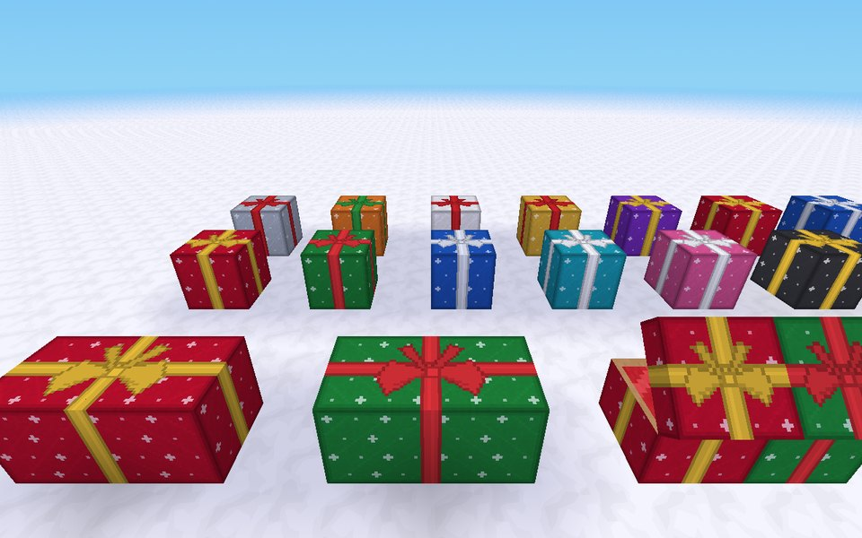
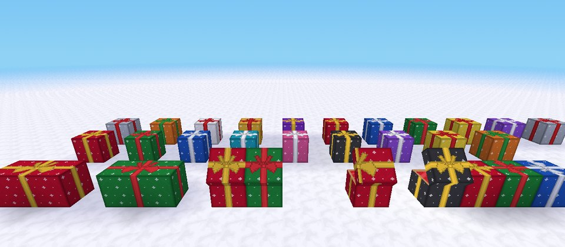

**Open chests:** the lid with the bow goes up, inside there is red tissue paper.

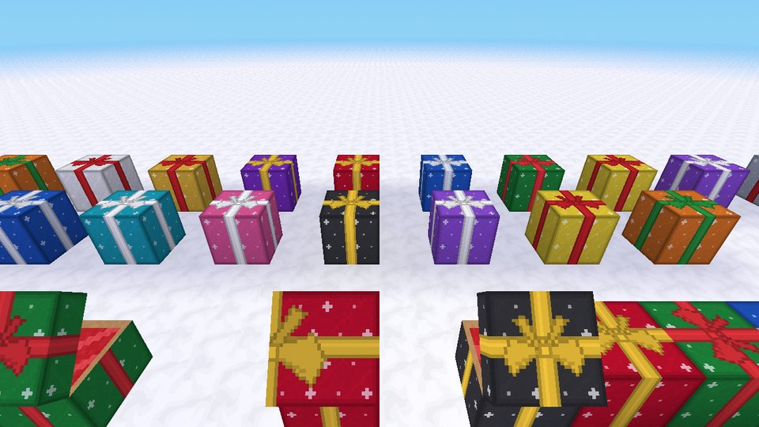

**technic chests** (iron, copper, silver, gold, mithril and the gold chests with colour labels) and the
padlock on locked chests:

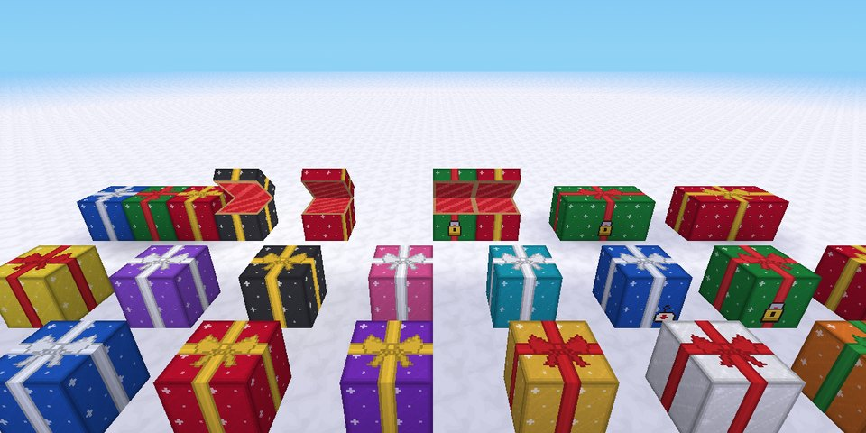

**techage chests** (shelter_ta): TA2 brown, TA3 dark blue, TA4 teal, TA5 violet.

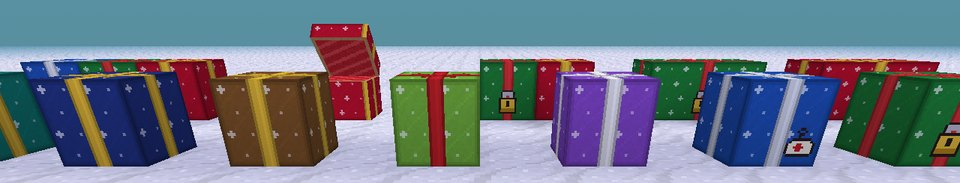

**Doors:** a wreath on every door, including glass, steel bar and prison doors and the protector doors.

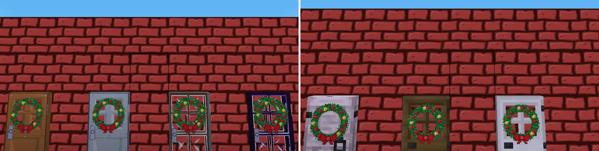
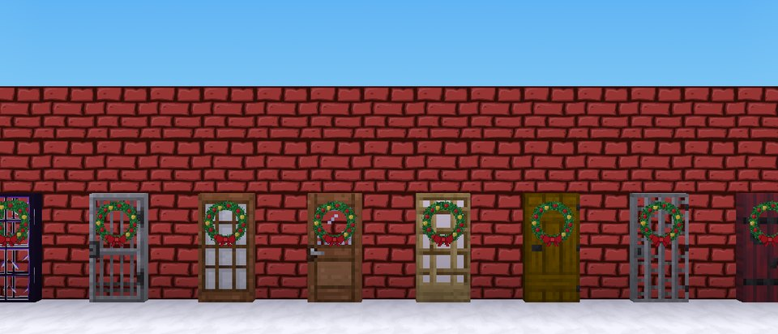

**Pine trees:** decorated Christmas trees with blinking garlands (day and evening).

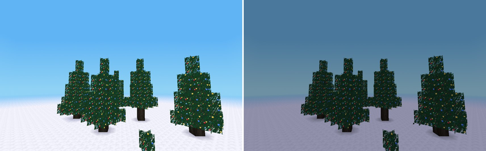
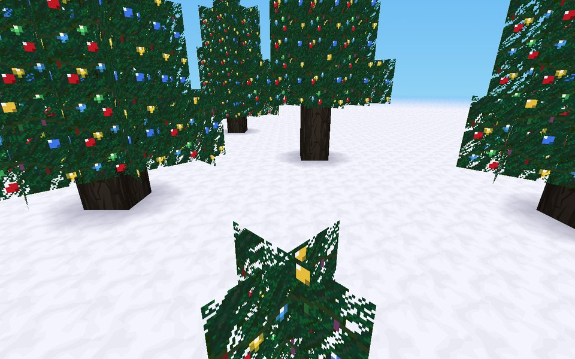

**Apples:** apples of ice.

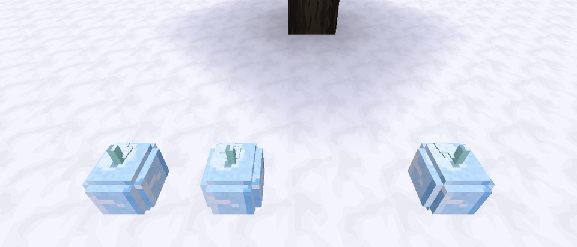

**Fences:** a palisade of candy canes, a striped gate and striped rails.

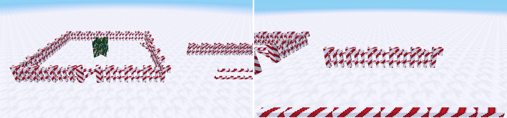

**Torches:** Christmas tree ornaments on the floor, on the walls and under the ceiling (day and night).

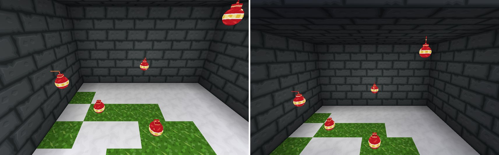

**Helmets:** a Santa hat on every helmet (armor stands on tiny_shelter and survival_shelter).

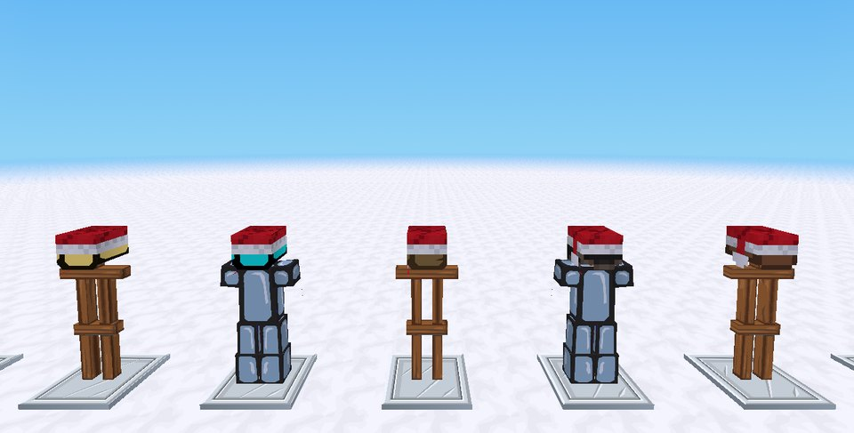
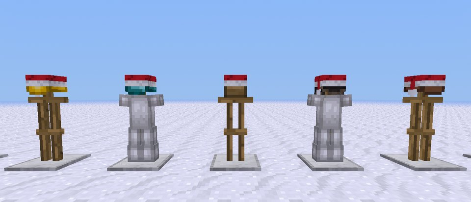

**Sheep:** red capes with white fur and Santa hats, also on shaved sheep. survival_shelter runs an older
sheep model, there the cape is a red wrap around the body.

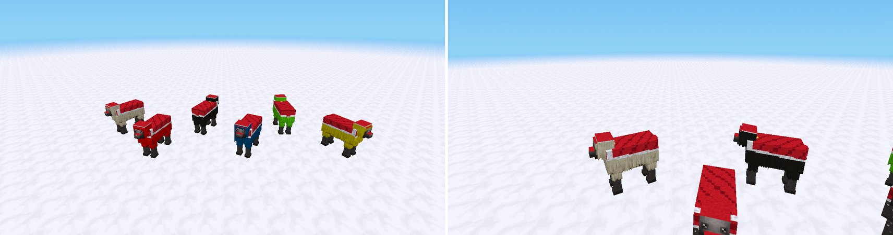
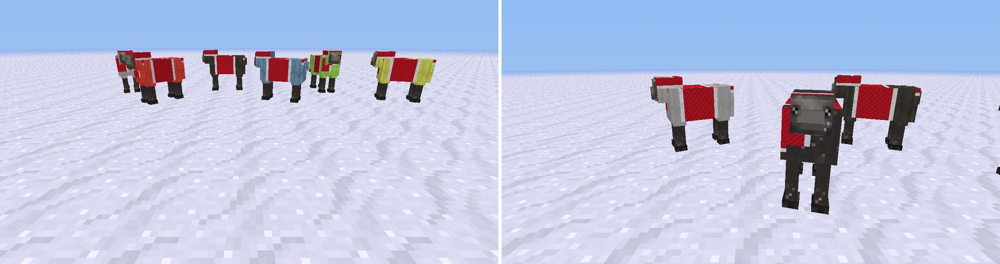

**Smartshops:** a garland instead of the border (day and night).

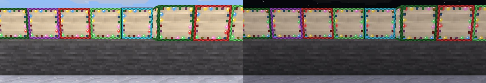

**Player bones:** snowmen.

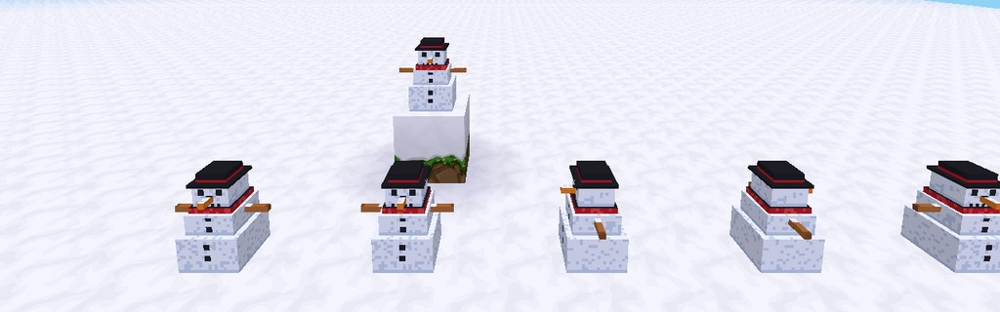

**Items in the hotbar:** ornament (torch), gifts (locked and protected chests), ice apple, candy cane fence,
door with a wreath, helmet with a Santa hat.

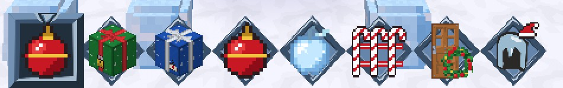

**unified_inventory:** light falling snow, snow drift with snowmen, gifts, candy canes and gingerbread men, a
glowing garland around the window. Crafting page, crafting guide, armor page, bags page and the lite layout.

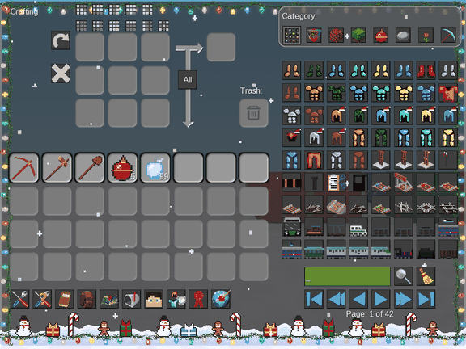
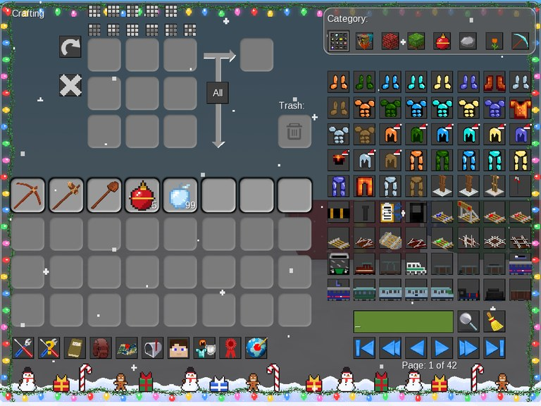
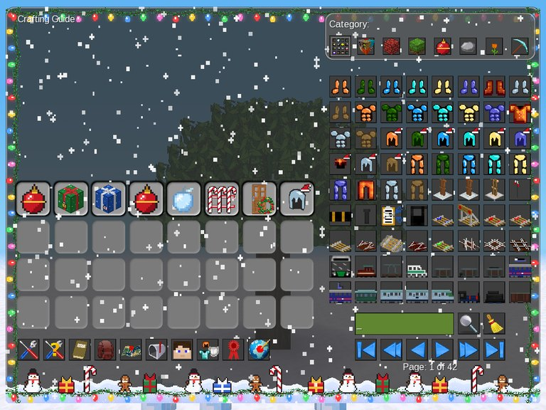
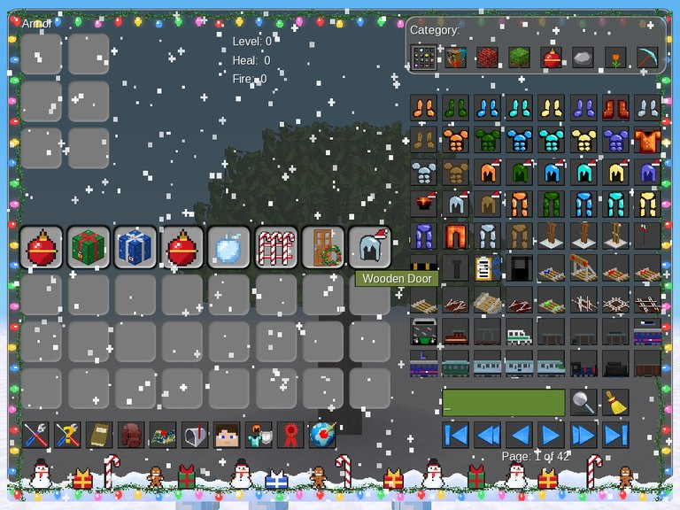
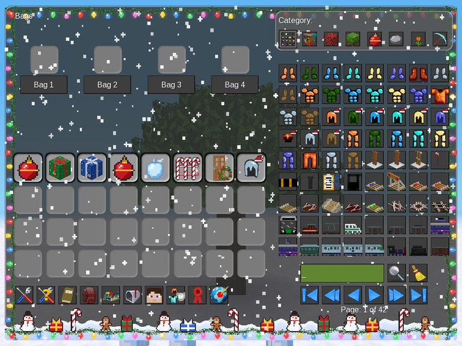
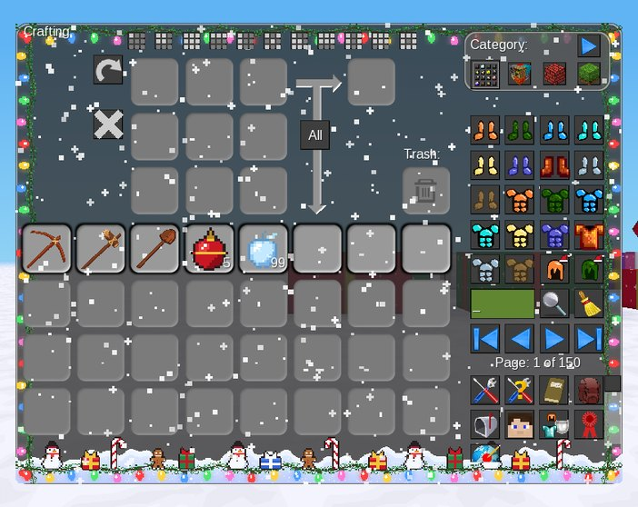

## How it works

- Everything happens in `minetest.register_on_mods_loaded` through `minetest.override_item`, so the
  definitions change only in the server's memory. If a mod is missing on a server, its part is skipped;
  all dependencies in `mod.conf` are optional.
- **Chests:** gift textures are grey scale (`christmas_view_gift_*.png`) and get their colour with
  `^[multiply`, so one set of files covers every colour. The colour depends on the chest name (a table in
  `init.lua`, unknown chests get a colour from a hash of their name). The open chest meshes
  (`chest_open.obj`, `connected_chest_open.obj`) get the same gift with an inside of red tissue paper.
- **Doors:** the wreath is an overlay drawn for the 38x32 layout of `door_a.b3d`/`door_b.b3d` (4x
  resolution, scaled automatically with texture packs). Protector doors are two nodes, the wreath goes on
  the top one.
- **Pine needles:** the tile becomes a 4-frame animation: the original needles texture (scaled to 64x64, so
  the high resolution needles of `artelhum_textures` work too) with a garland overlay whose bulbs light up
  in turn. The animation runs on the client only. The needles do not emit light: a light source would be
  stored in the map and stay after removing the mod.
- **Fences:** the `node_box` is replaced by candy canes; `collision_box`/`selection_box` are set to the
  original node box, so the physics do not change.
- **Torches:** three OBJ meshes (`models/christmas_view_ornament_*.obj`) for the floor, wall and ceiling
  nodes, the `wallmounted` placement logic of `default` stays untouched.
- **Smartshops:** the tile becomes a 4-frame animation of the shop face with a grey wire
  (`christmas_view_shop_wire.png`, coloured with `^[multiply` in the status colour of the node) and the
  bulbs on top (`christmas_view_shop_bulbs.png`). Shops keep their light, entities and formspecs.
- **Bones:** `bones:bones` becomes a `nodebox` snowman with `paramtype = "light"`; the collision and
  selection boxes stay a full block. Bones that already lie in the world may look dark until the light
  around them updates (a node is placed or dug next to them).
- **Helmets:** the Santa hat is drawn on the hat layer of the 3d_armor texture (64x32), so the helmet
  itself stays visible under it.
- **Sheep:** the cape and the hat are an overlay added to the texture of the live object only
  (`set_properties`). The mob's own fields (`base_texture` etc.) are left alone, so nothing ends up in the
  saved staticdata. mobs_animal resets the texture on shearing, dyeing and wool regrowth, so the mod checks
  it again every 0.5 s. survival_shelter (older mobs_animal, separate shaved model) is detected by
  `models/mobs_sheep_shaved.b3d` and uses the `christmas_view_sheep_old*.png` overlays.
- **unified_inventory:** the mod wraps `unified_inventory.get_formspec` and inserts its elements right
  after the standard background, so everything is drawn under the slots, buttons and text. The window
  gets 0.9 taller for the snow drift. The snow is a grid of seamless `animated_image[]` tiles with only a few slow flakes each. Nothing is
  stored, only the formspec sent to the client changes.

## Installation

Put the folder into `minetest_game/mods/` of the server **as `christmas_view`** (the folder name must be
written in Latin letters and match `name` in `mod.conf`). Mods inside the game load automatically, so
there is no need to enable it in `world.mt`. Restart the server.

## Removing after Christmas

1. Stop the server.
2. Delete the `minetest_game/mods/christmas_view` folder.
3. Start the server.

Nothing has to be cleaned up: no node, item or entity of this mod exists in the world. After the restart
players see the normal chests, doors, trees, apples, fences, torches, smartshops, bones, helmets, sheep and inventory window
again. If a client still shows the old textures from its cache, reconnecting is enough.

## Files

```
christmas_view/
├── mod.conf
├── init.lua          — all the look-swapping logic
├── textures/         — generated textures (christmas_view_*.png)
├── models/           — Christmas tree ornament meshes for the torches (.obj)
├── screenshots/      — screenshots for this README (not used by the game)
└── tools/            — texture and model generator (not used by the game)
    ├── gen_textures.py
    └── b3d.py        — reader for the sheep .b3d models
```

## Regenerating textures

All PNG and OBJ files are produced by `tools/gen_textures.py` (Python 3, `numpy`, `Pillow`):

```bash
python3 tools/gen_textures.py NEW OLD OLD_SHAVED
```

Without arguments everything except the sheep overlays is generated. The sheep arguments have the form
`<model.b3d>:<tex1.png>,<tex2.png>,...`:

- **NEW**: `mobs_sheep.b3d` + `mobs_sheep_base.png`, `mobs_sheep_wool.png` from tiny_shelter or shelter_ta
  (`mobs_sheep_shaved.png` is taken from the same folder for the shaved overlay);
- **OLD**: the same files from survival_shelter (older mobs_animal);
- **OLD_SHAVED**: `mobs_sheep_shaved.b3d` + `mobs_sheep_shaved.png` from survival_shelter.
